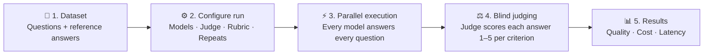
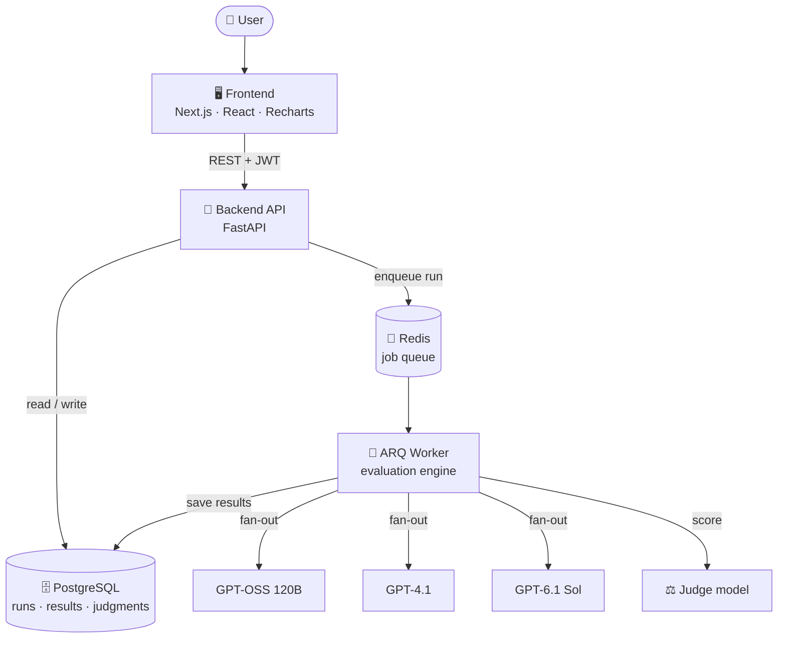

<div align="center">

# 🔍 TokenLens

**Which LLM should we use, and is it worth the price?**

TokenLens runs several large language models on the same questions at the same time.
An impartial AI judge scores every answer, and the cost, speed and quality of each model are shown side by side.

[**🚀 Live Demo**](https://gsg-fron-end-hmbteeahd6dbd4fp.uaenorth-01.azurewebsites.net/) · [How it works](#-how-it-works) · [Run it locally](#-run-it-locally) · [Team](#-team)


*Built in the Simera Market Ready Developer Program*

</div>


---

## 📌 The Problem

Every company that adds AI to its product has to answer the same question: **which model?**

- There are dozens of models, and prices for the same task can differ by **more than 10x**.
- The usual way to choose is to try a few questions by hand and go with a gut feeling. That is slow and subjective, and it can't be repeated.
- Quality, cost and speed are reported in different places, so nobody sees the full trade-off.
- When a provider updates a model, no one notices if the answers get worse.

## 💡 The Solution

TokenLens turns model selection into a **measured, repeatable experiment**:

| Instead of… | TokenLens gives you… |
|---|---|
| Testing a few questions by hand | A full dataset sent to every model **in parallel** |
| "This answer feels better" | A **blind AI judge** scoring each answer against a weighted rubric |
| Checking pricing pages | **Exact cost per answer**, calculated from the real token counts |
| Results lost in chat windows | Every run **saved**, with history and comparison |
| Hoping nothing changed | **Regression alerts** when quality drops below a baseline |

---

## 🎬 Live Demo

**👉 [Open TokenLens](https://gsg-fron-end-hmbteeahd6dbd4fp.uaenorth-01.azurewebsites.net/)**

| Role | Email | Password |
|---|---|---|
| Admin | `motaha@engineer.com` | `1234` |
| User | `user@gsg.com` | `12345678` |

**Try it in four steps:**
1. Log in and open **New Run**.
2. Choose the built-in **Nimbus Support Q&A** dataset and the **Support Quality** rubric.
3. Choose two or more models and a judge, then click **Run Evaluation**.
4. When the run finishes, open it from **Run History** to see scores, costs and latency per model and per question.

---

## ⚙️ How It Works



1. **Upload a dataset.** A CSV of questions, each with an optional reference answer. Example: real customer-support questions.
2. **Configure a run.** Choose 2–8 models to compare, one judge model, a rubric, and how many times to repeat each question (1–5).
3. **Parallel execution.** A background worker sends each question to all models at the same time. If one model fails or times out, the others keep going.
4. **Blind judging.** The judge sees the policy, the question, the reference answer and the candidate answer, but **never which model wrote it**. It scores each criterion from 1 to 5 and gives a short reason for each score.
5. **Results.** TokenLens calculates the weighted score in code (the judge never adds up its own score), together with the cost and latency of every answer.

---

## 🏗️ Architecture



**Why a queue?** An evaluation can take minutes (20 questions × 3 models × 3 repeats, plus a judge call for each answer). The API puts the job on a queue and responds immediately, and a separate worker does the heavy work in the background. The interface stays responsive and runs survive page refreshes.

| Service | Role |
|---|---|
| `frontend` | Next.js app: dashboard, new run, run history, detailed results, datasets, models, admin |
| `backend` | FastAPI REST API: authentication, datasets, rubrics, models, runs. Swagger docs at `/docs` |
| `worker` | Same image as the backend, but runs the ARQ worker that executes evaluations |
| `postgres` | Persistent storage for users, datasets, runs, results, judgments and regression alerts |
| `redis` | Job queue between the API and the worker |

---

## ✨ Key Features

| | Feature | What it means |
|---|---|---|
| ⚡ | **Parallel fan-out** | All models answer every question at the same time, with per-provider concurrency limits so we stay within rate limits |
| 🔁 | **Retry with backoff** | Timeouts, 429s and 5xx errors are retried with jittered backoff. Real errors (4xx) fail fast and are recorded |
| ⚖️ | **Blind judge** | The judge never sees model names, and a model can't be the judge of a run it competes in |
| 🧮 | **Deterministic scoring** | The judge scores each criterion; the weighted total is computed in Python, not by the LLM |
| 🛡️ | **Strict JSON parsing** | If the judge returns invalid output, it gets one retry with the error explained. If it fails again, the judgment is marked failed and no score is invented |
| 💰 | **Exact cost tracking** | Input, cached, output and reasoning tokens are billed separately, using a price snapshot saved with each result |
| 🔒 | **Versioned rubrics** | Editing a rubric creates a new version, so old scores always refer to the rubric they were graded with |
| 📈 | **Regression alerts** | A new run is compared against a frozen "golden" baseline, and an alert names the criterion that dropped |
| 👥 | **Roles** | Admin and member accounts with JWT authentication |

---

## 🎯 Can We Trust the Judge?

An AI judge is only useful if its scores are reliable. TokenLens doesn't assume this. It **measures** it:

| Check | Question it answers |
|---|---|
| **Run-to-run variance** | If the judge scores the same answer several times, how much does the score move? A gap between two models only counts if it is larger than this noise. |
| **Position bias** | In a head-to-head comparison, does swapping answers A and B change the winner? |
| **Length bias** | Given two equally correct answers, does the judge prefer the longer one? |
| **Human agreement** | A blind scoring sheet (model names removed, order shuffled) lets a person score the same answers, and we measure how often the judge and the person agree. |
| **Noise-based thresholds** | A regression alert fires only when quality falls by more than **2× the judge's own noise**, so random variation doesn't trigger false alarms. |

---

## 📐 The Rubric

Each answer is scored from **1 to 5** on four weighted criteria, and every level has a written definition so the judge can't make up its own scale.

| Criterion | Weight | What it measures |
|---|:---:|---|
| **Policy fidelity** | 40% | Follows the company policy exactly and applies only rules the policy actually contains |
| **Completeness** | 25% | Covers every rule the question needs, including cases where two rules combine |
| **Honesty** | 20% | Says when the policy doesn't cover a case, and corrects false assumptions in the question |
| **Conciseness** | 15% | Direct, with no filler or repeated boilerplate |

> **Final score** = 0.40 × fidelity + 0.25 × completeness + 0.20 × honesty + 0.15 × conciseness

Admins can create their own rubrics for other domains, as long as the weights add up to 1.

---

## 🤖 Models

All models are deployed on **Azure AI Foundry**, except Gemini, which uses **Google AI Studio**.

| Model | Role | Input $/1M tokens | Output $/1M tokens |
|---|---|:---:|:---:|
| GPT-OSS 120B | Compared (budget) | $0.15 | $0.60 |
| GPT-4.1 | Compared (mid-range) | $2.00 | $8.00 |
| GPT-6.1 Sol | Compared (premium) | $2.00 | $10.00 |
| **Llama 3.3 70B Instruct** | **Default judge** | $0.71 | $0.71 |
| GPT-6 Astra | Judge | $1.00 | $3.00 |
| Gemini 3.8 Flash | Cross-check judge | $0.30 | $2.50 |

The input price varies about **13x** between the cheapest and the most expensive compared model, which is exactly the cost-versus-quality trade-off TokenLens is built to measure. The default judge comes from a **different model family** (Meta) than the compared models (OpenAI), so it has no reason to favor its own family's answers.

Adding a model means adding one row to `backend/evaluation/registry.py`.

---

## 🧪 Sample Dataset: Nimbus Support Q&A

A new installation comes with a ready-made demo: **Nimbus**, a fictional cloud-backup company with a written subscription policy (plans, refunds, upgrades, downgrades) and 20 customer-support questions.

The questions are designed to test what matters in real support: simple lookups, cases where **two rules interact** (for example, upgrading ends the refund window), questions **the policy doesn't cover**, and questions with a **false assumption** the model needs to correct.

### Using your own dataset

Upload a `.csv` (or a `.jsonl` file with the same fields) with these columns:

```csv
input,expected_output
"How many devices can I connect on the Lite plan?","The Lite plan supports 1 device."
```

| Column | Required | Description |
|---|:---:|---|
| `input` | ✅ | The question sent to each model |
| `expected_output` | — | The reference answer the judge compares against |

---

## 🚀 Run It Locally

**Prerequisites:** Docker Desktop, plus an Azure AI Foundry key and/or a Google AI Studio key.

```bash
git clone https://github.com/AlaaMousa05/TokenLens.git
cd TokenLens
cp .env.example .env        # then fill in AZURE_API_KEY, GOOGLE_API_KEY and JWT_SECRET_KEY
docker compose up --build
```

| What | URL |
|---|---|
| Frontend | http://localhost:3000 |
| Backend API | http://localhost:8000 |
| API docs (Swagger) | http://localhost:8000/docs |
| Health check | http://localhost:8000/health |

On startup the backend creates the tables and registers all models. The demo dataset and rubric are added at startup once at least one user exists, so after you sign up for the first time, restart the backend (`docker compose restart backend`) or run `python -m scripts.seed_data`.

> **Port 3000 already in use?** Run `docker ps` to find the container using it, then `docker stop <name>`.

<details>
<summary><b>Environment variables</b></summary>

| Variable | Used by | Purpose |
|---|---|---|
| `POSTGRES_USER`, `POSTGRES_PASSWORD`, `POSTGRES_DB` | postgres | Database credentials |
| `DATABASE_URL` | backend, worker | Async PostgreSQL connection string |
| `REDIS_URL` | backend, worker | Job queue connection (the API and the worker must use the same one) |
| `JWT_SECRET_KEY` | backend | Signs access tokens; use a long random value |
| `AZURE_API_KEY` | backend, worker | Azure AI Foundry models |
| `GOOGLE_API_KEY` | backend, worker | Gemini judge |
| `NEXT_PUBLIC_API_URL` | frontend | Backend URL the browser calls (not a secret) |
| `CORS_ALLOWED_ORIGINS` | backend | Comma-separated allowed origins; defaults to `*` |

Provider keys are passed **only** to the backend and the worker. The frontend container never receives them, so a key can't end up in the browser bundle.

</details>

<details>
<summary><b>Running the backend and worker without Docker</b></summary>

```bash
cd backend
python -m pip install -r requirements.txt
python -m uvicorn app.main:app --host 127.0.0.1 --port 8000
```

In a second terminal, from the same `backend` folder:

```bash
python -m arq worker.main.WorkerSettings
```

The worker has to keep running. Clicking **Run Evaluation** only adds a job to the queue; the worker is what processes it.

</details>

<details>
<summary><b>Running the tests</b></summary>

```bash
cd backend
pip install -r requirements-dev.txt
pytest
```

More than 120 tests cover execution (fan-out, retry, concurrency, cache), judging (rubric, prompt, pairwise), measurement (variance, bias, agreement, statistics), providers and regression detection.

</details>

---

## 🔌 API Overview

| Resource | Endpoints |
|---|---|
| `/auth` | Register, log in, current user |
| `/users` | Profile and admin user management |
| `/models` | List, add, update and deactivate models |
| `/datasets` | Upload a CSV, list, edit and delete datasets and their items |
| `/rubrics` | Create, list, revise and delete rubrics |
| `/runs` | Create a run, list run history, get a run and its detailed results |

The full interactive documentation is at **`/docs`**.

---

## 📁 Project Structure

```
TokenLens/
├── frontend/                  Next.js app
│   ├── app/(protected)/       dashboard, newrun, runhistory, runresult, datasets, models, admin
│   └── Components/            Navbar, SideBar, StatCards, tables
├── backend/
│   ├── app/                   FastAPI: controllers → services → models / schemas
│   ├── worker/                ARQ worker that executes queued runs
│   ├── evaluation/            the evaluation engine
│   │   ├── providers/         Azure (OpenAI-compatible) and Google adapters
│   │   ├── execution/         fan-out, retry, concurrency limits, cache
│   │   ├── judging/           rubric, judge, prompt, parser, guards
│   │   ├── measurement/       variance, position/length bias, human agreement
│   │   ├── regression/        golden baseline, threshold, comparison
│   │   ├── registry.py        every model, price and judge in one place
│   │   └── cost.py            per-call cost calculation
│   ├── alembic/               database migrations
│   ├── scripts/               offline tools: full runs, bias and variance probes, regression check
│   └── tests/
├── .github/workflows/         Azure deployment pipelines
└── docker-compose.yml
```

---

## 👥 Team

| Member | Role |
|---|---|
| **Alaa Mousa** | Team Lead · AI Engineer · Backend |
| **Mohammad Taha** | Backend Engineer |
| **Nadeen Abu Hilweh** | Frontend Engineer |
| **Tharaa Sukaina** | Frontend Engineer |

